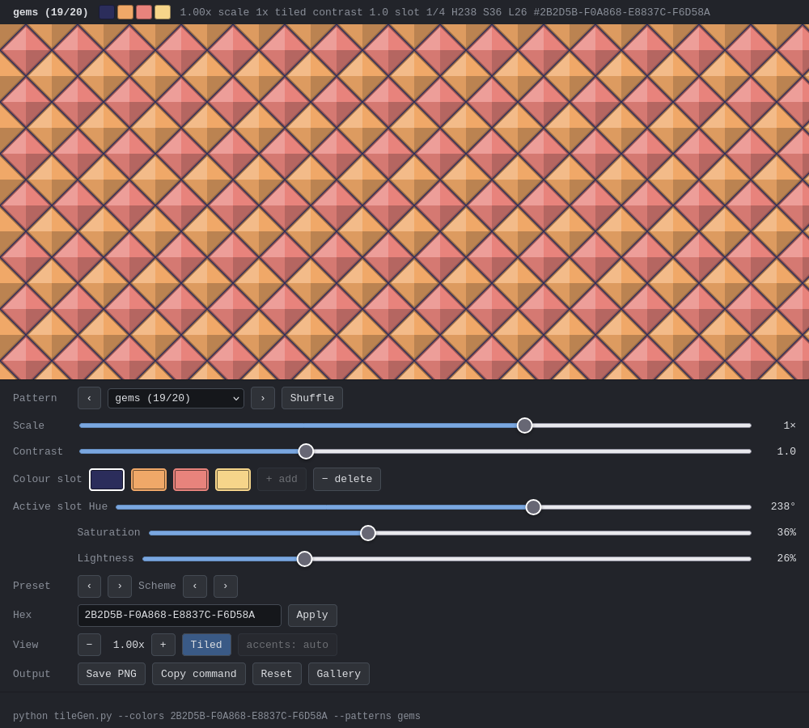
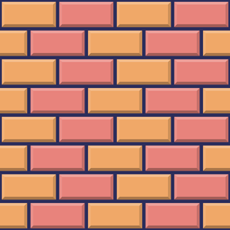
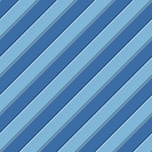
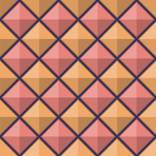
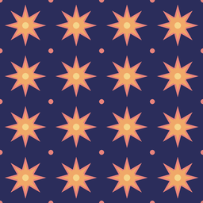
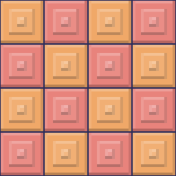
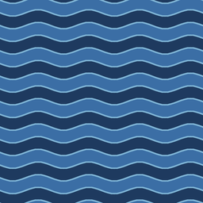
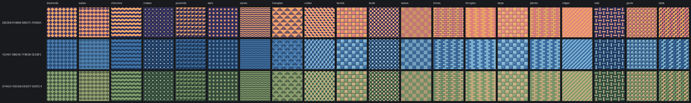
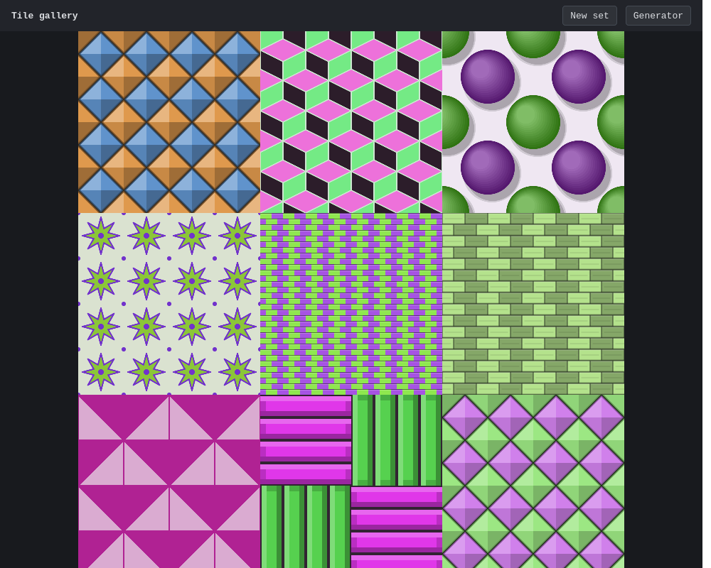

# tileGen

Seamless background tile generator. Makes 256×256 PNG tiles that repeat with
no visible seams, in 20 patterns (8 flat, 12 with 2.5D shading), with
single-colour tone-on-tone or 2–4 colour palettes.

## Example tiles

| | | |
|---|---|---|
|  |  |  |
|  |  |  |

Every pattern in three palettes (sunset, ocean, forest), rendered by the
command-line tool:

## The three tools

| File | What it is |
|---|---|
| `tileGen.py` | Command-line generator. Writes PNG tiles. |
| `tileGen.html` | Browser generator and gallery. No install: open the file, or host it on GitHub Pages. |
| `tileGen_preview.py` | Interactive terminal preview with live colour and pattern controls. |

`termgfx.py` is a helper module used by the terminal preview to draw real
images in kitty, iTerm2 or sixel terminals.

### Browser tool

Open `tileGen.html` in any modern browser.

- A plain open starts with a random look.
- Sliders and buttons change the pattern, scale, contrast, colour slots
  (hue, saturation, lightness), presets, schemes and zoom.
- **Save PNG** downloads the 256px tile.
- **Copy command** gives the matching `tileGen.py` command.
- **Gallery** (`tileGen.html?gallery=1`) shows a page of random tiles. Click one to
  open it in the generator with the same settings.

Settings can be passed in the URL, for example:

    tileGen.html?colors=sunset&pattern=bricks&scale=2&contrast=1.2

### Command line

    pip install -r requirements.txt

    python tileGen.py                                     # every pattern, default palette -> ./tiles
    python tileGen.py --colors sunset ocean --patterns gems ridges
    python tileGen.py --colors 1E3A5F-F0A868-E8837C --patterns cubes   # multi-colour
    python tileGen.py --colors forest --patterns slabs --scale 2       # bigger pattern
    python tileGen.py --schemes --zip                     # every built-in scheme, zipped
    python tileGen.py --list                              # patterns, palette, schemes

Colours are hex codes, dash-joined palettes (background first), or built-in
names. Palettes: `blue`, `dark blue`, `tan`, `teal`, ... Schemes: `sunset`, `ocean`,
`forest`, `berry`, `slate-orange`, `teal-gold`, `retro`.

### Terminal preview

    python tileGen_preview.py sunset bricks
    python tileGen_preview.py --once --size 120x40 ocean weave   # print one frame

Keys: arrows change pattern and contrast, `1`–`4` pick a colour slot, `h s l`
tune it, `m` cycles schemes, `x` types a hex palette, `+ -` zoom, `w` saves
the tile, `q` quits and prints the matching `tileGen.py` command. Run it
in a terminal that supports images (kitty, iTerm2, sixel) for real pixels, or
use `--protocol blocks` for half-block characters.

## Patterns

- **Flat:** `diamonds`, `scales`, `chevrons`, `crosses`, `pyramids`, `stars`, `waves`, `triangles`
- **2.5D:** `cubes`, `bevels`, `studs`, `weave`, `bricks`, `shingles`, `steps`,
  `planks`, `ridges`, `rods`, `gems`, `slabs`

`--scale` changes the size of the pattern inside the tile: `0.25`, `0.5`, `1`
(default) or `2`. Tiles stay seamless at every scale.

## Requirements

- Python 3.9+, Pillow and numpy (see `requirements.txt`)
- A modern browser for `tileGen.html` (no build step, no network calls)

## Licence

MIT. See [LICENSE](LICENSE).
